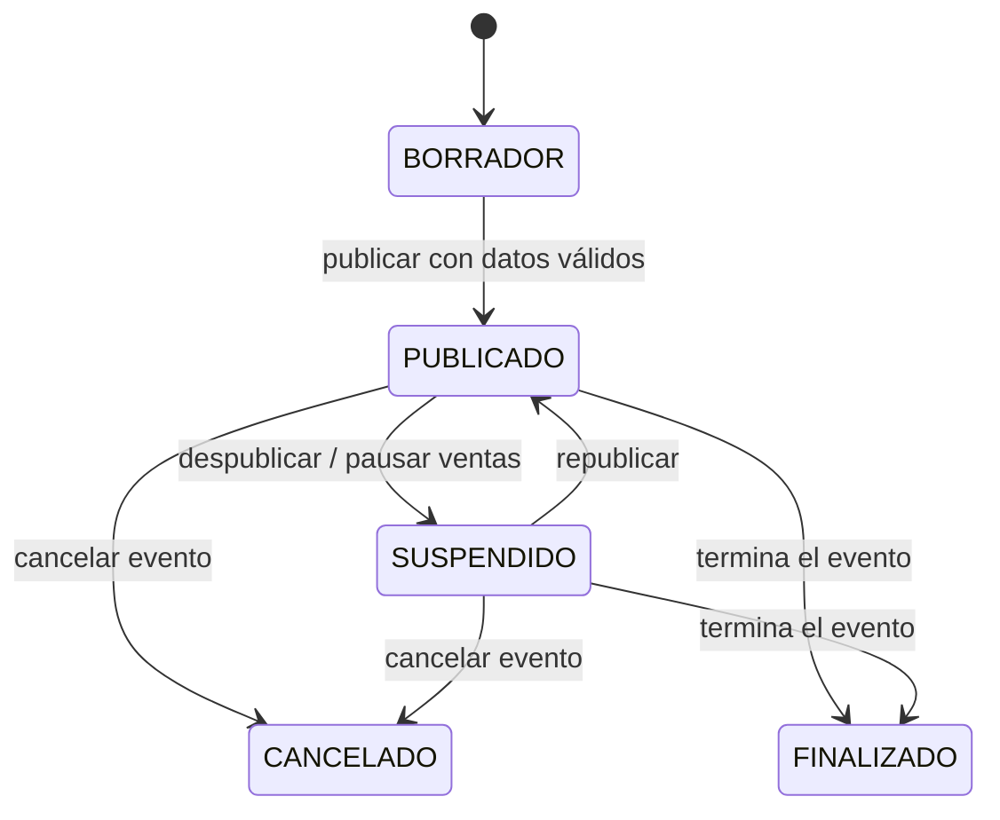
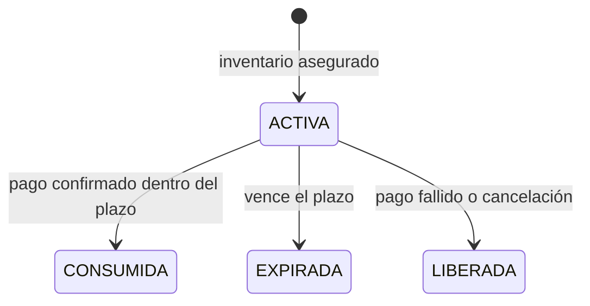
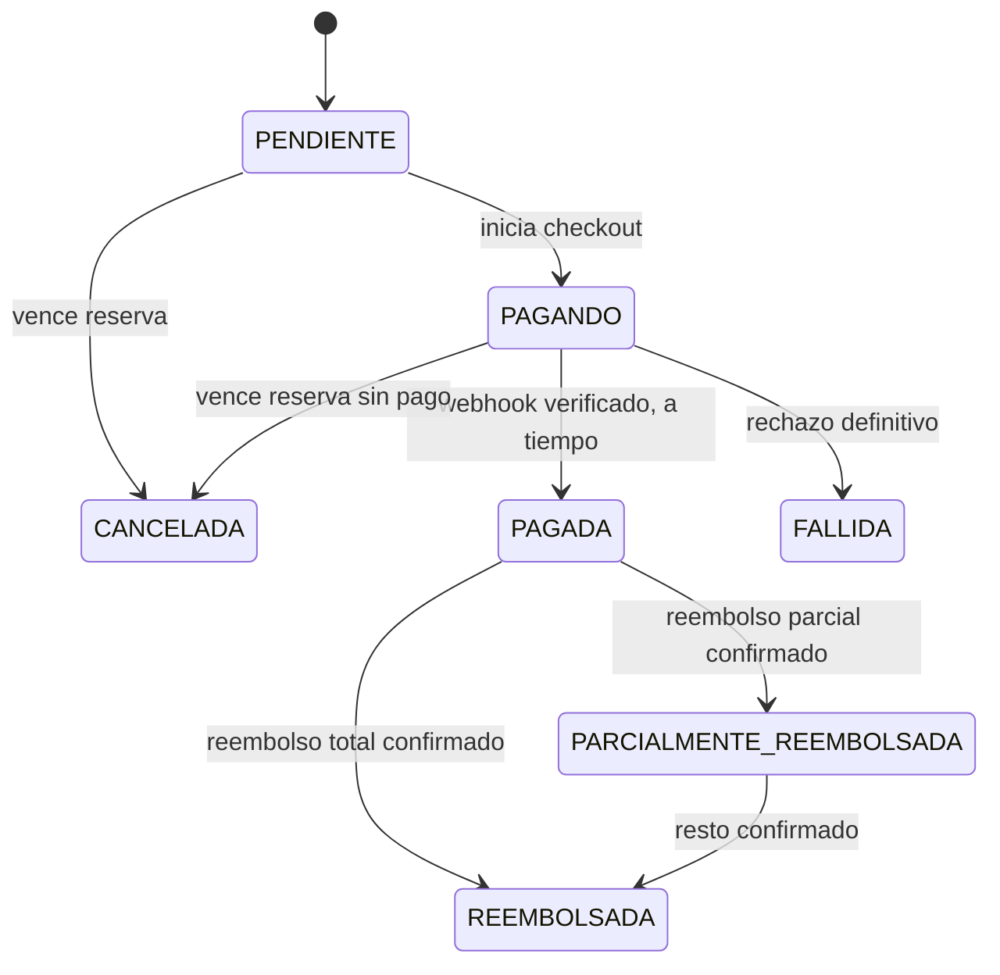
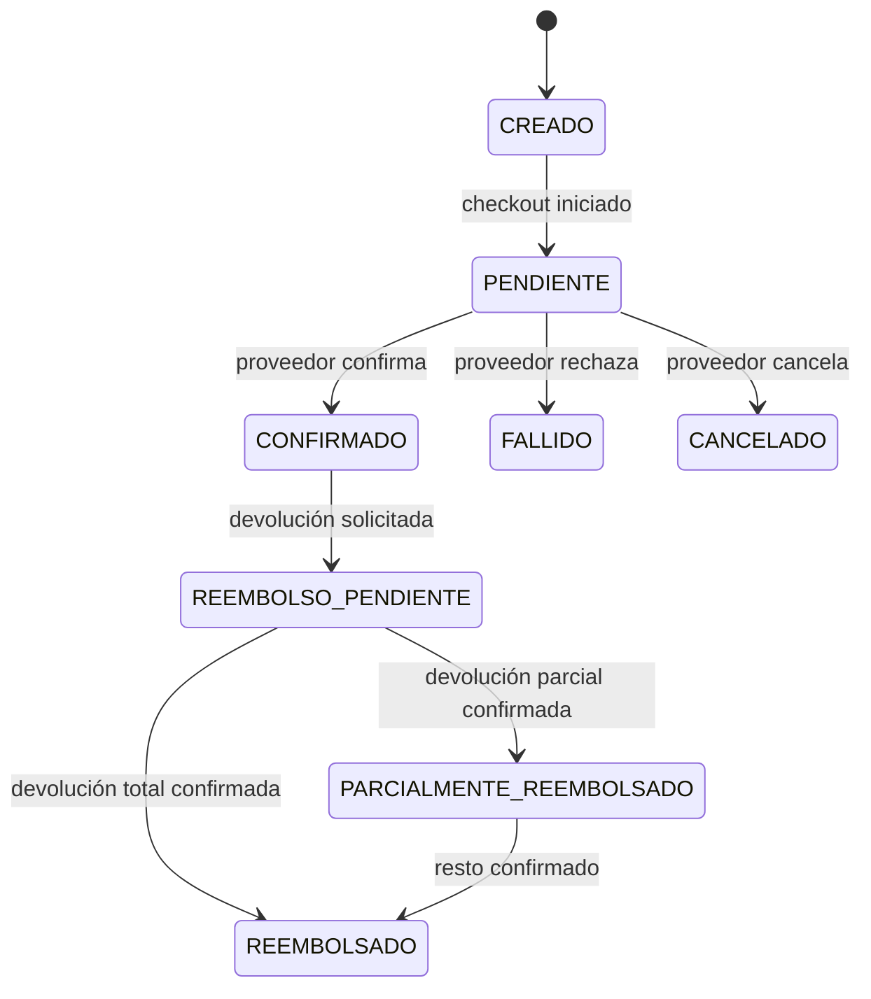
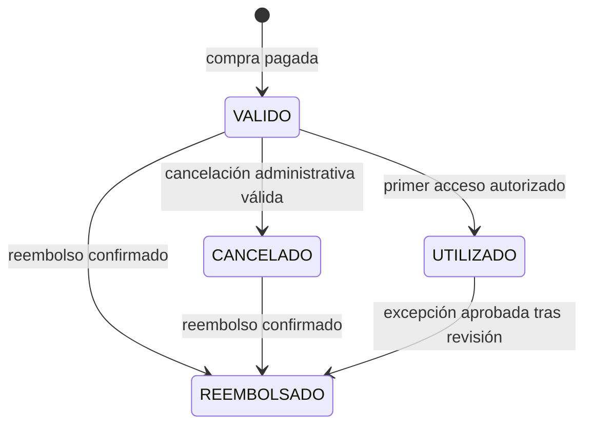
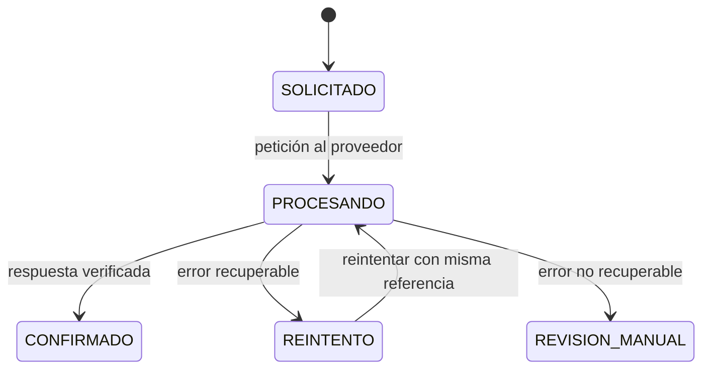

# Estados y reglas comerciales

**Estado: borrador de F01-T03, F01-T04 y F01-T05.** Las cantidades y políticas marcadas como confirmadas proceden de las respuestas del propietario del proyecto. Los estados son el lenguaje de negocio; F02 definirá los nombres exactos en datos y API.

## Eventos

`AGOTADO` es una **condición calculada** cuando ningún tipo de entrada tiene inventario vendible; no será un estado persistente que pueda quedar desactualizado. Un evento cancelado bloquea nuevas reservas y pagos, inicia la política de reembolso y no vuelve a publicarse. **Confirmado:** las ventas cierran al iniciar el evento y el escaneo se permite hasta su hora de finalización. El administrador interno es el único que publica en el MVP.

## Reservas e inventario

- **Confirmado:** la reserva dura **10 minutos** a partir del instante en que el backend la crea. Se persiste `expira_en`; el reloj del navegador solo presenta una cuenta regresiva.
- **Confirmado:** máximo general de **4 entradas por compra y 4 por cliente para un mismo evento**. La segunda regla suma entradas ya pagadas y reservas activas del cliente; una nueva compra no permite superar el máximo mediante solicitudes simultáneas. El administrador puede reducir el máximo para un tipo de entrada, nunca aumentarlo por encima del general sin cambiar esta política.
- La disponibilidad se calcula desde stock total menos entradas vendidas y reservas activas; reservas expiradas no bloquean inventario aunque el worker aún no haya actualizado su estado.
- La creación, consumo y liberación de reservas son operaciones atómicas e idempotentes. La misma reserva no libera inventario dos veces. No se abre una transacción de base de datos mientras se llama al proveedor de pagos.
- No se reserva fuera de la ventana de venta, desde el inicio del evento ni para eventos suspendidos, cancelados, finalizados o agotados.
- **Confirmado:** la venta termina al empezar el evento. Cada tipo de boleto puede cerrar antes, pero nunca después. El scanner admite accesos desde el inicio hasta la hora de finalización del evento; si el negocio necesita ingreso anticipado, esta política deberá revisarse antes de implementar el scanner.

## Compra y pago

- **Confirmado:** el primer lanzamiento acepta **solo tarjeta** y cobra únicamente en **MXN**. Stripe se utiliza en sandbox durante desarrollo; activar cobros reales es un hito posterior.
- **Confirmado:** el precio publicado es el **total que pagará el cliente**, sin cargo de servicio adicional en el MVP. El resumen muestra cantidad, precio unitario y total; el servidor calcula los importes y guarda una copia inmutable en la compra. El tratamiento fiscal y los comprobantes requieren revisión antes de ventas reales.
- El navegador nunca marca una compra pagada. Un webhook autenticado y reconciliado con referencia, importe y moneda es la fuente de confirmación. Repetirlo no emite tickets duplicados.
- **Confirmado:** si el proveedor confirma el pago **después** de que expiró la reserva, no se emiten boletos. Se registra el cobro tardío, se solicita reembolso íntegro y se mantiene seguimiento hasta la confirmación del proveedor. Un fallo de reembolso genera reintento y aviso operativo, sin declarar que el dinero ya fue devuelto.
- El resultado `PAGADA` solo se produce si la reserva seguía vigente en el momento de confirmar y su inventario estaba asegurado. El instante de expiración es exclusivo: `ahora < expira_en` admite confirmación, `ahora >= expira_en` se trata como pago tardío. F02 definirá el orden exacto de bloqueo para cumplirlo bajo concurrencia.

El pago y la compra son registros distintos. Un pago `CONFIRMADO` puede corresponder a una compra `CANCELADA` si llegó tarde; entonces se inicia el reembolso sin emitir tickets. Cada intento de pago conserva su referencia externa y sus webhooks se procesan una sola vez.

## Tickets, accesos y reembolsos

Cada unidad comprada produce un ticket y una credencial QR independientes. Solo `VALIDO` admite acceso. El consumo se hace en una transacción con una restricción que garantiza un único acceso válido por ticket; un segundo escaneo recibe `YA UTILIZADO`. Todos los intentos, aceptados o rechazados, se registran sin exponer datos de pago al personal de acceso.

- **Confirmado:** la cancelación voluntaria de una compra de un evento vigente **no genera reembolso** en el MVP. El administrador inicia reembolsos por cancelación del evento y por cobros tardíos.
- Cuando el administrador cancela un evento, se bloquean ventas, se identifican compras y tickets afectados y se encolan reembolsos de entradas **no utilizadas**. Sus QR dejan de ser válidos inmediatamente; el estado `REEMBOLSADO` se alcanza solo al confirmar el proveedor.
- **Confirmado:** si el evento se cancela después de registrar accesos, los tickets **utilizados** pasan a **revisión manual**; no se reembolsan automáticamente. Se registra la decisión y quién la tomó.
- Una solicitud repetida de reembolso no genera dos devoluciones. La compra y los tickets no se marcan reembolsados hasta la confirmación verificada del proveedor.
- **Confirmado:** el administrador interno resuelve los casos de revisión manual y su decisión queda auditada. Los plazos de atención y textos de comunicación se fijarán antes de ventas reales. Las obligaciones legales aplicables se revisarán antes del lanzamiento.

## Invariantes para el diseño de F02

1. La suma de entradas vendidas y reservadas vigentes nunca supera el stock.
2. El máximo por cliente se aplica bajo concurrencia a compras pagadas y reservas vigentes.
3. Una confirmación de pago verificable produce como máximo un conjunto de tickets.
4. Un ticket produce como máximo un acceso válido.
5. Un reembolso se solicita y confirma de forma idempotente.
6. Precios, estado del pago, permisos, límites y QR se validan en el backend.
