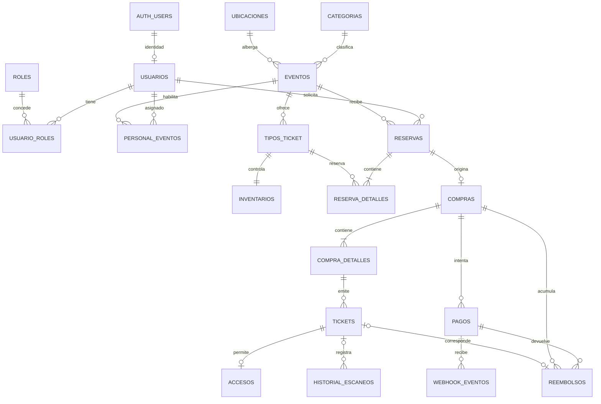

# Modelo de datos y diferencias con la base existente

Fuente de reglas: [fase 01](../fase-01/README.md). Fuente del estado actual: consulta de solo lectura del catálogo PostgreSQL del proyecto Supabase de desarrollo, 25 de octubre de 2026. **Las propuestas de este documento todavía no están aplicadas.**

## Modelo entidad-relación

`auth.users` mantiene las credenciales; `tickets_app.usuarios` conserva el perfil y el identificador de Auth. Un usuario puede tener varios roles globales y asignaciones de personal por evento. `personal_eventos` vincula evento, usuario y rol; su estado y vigencia se comprueban al escanear.

`evento_imagenes` pertenece a `eventos`; `notificaciones` a `usuarios` cuando existe destinatario; `auditoria` registra actor y entidad; `outbox_trabajos` e `idempotencia_solicitudes` sostienen los reintentos. La relación `webhook_eventos.payment_id` puede ser nula mientras se identifica el pago. Los detalles de reserva y compra tienen claves foráneas compuestas que impiden mezclar un tipo de entrada con otro evento. Los tickets vinculan detalle de compra y pago a la misma compra. La base ya tiene 37 claves foráneas, incluida la referencia de `usuarios.auth_user_id` a `auth.users.id`.

## Claves e invariantes verificadas

| Regla | Soporte actual | Trabajo de F02 |
|---|---|---|
| Identidad única | `usuarios.auth_user_id` único; `roles.code` único; `usuario_roles` usa clave `(user_id, role_id)`. | Mantener `auth.users` fuera de las migraciones de negocio. Documentar baja o anonimización del perfil. |
| Publicación | `categorias.slug` y `eventos.slug` únicos; fechas de evento con `ends_at > starts_at`. | Guardar zona IANA en el evento y alinear sus estados con F01. Validar inicio y cierre de ventas al publicar. |
| Venta e importes | `tipos_ticket` tiene precio en centavos no negativo, moneda MXN, cantidad positiva y límites positivos. `reserva_detalles` y `compra_detalles` comprueban `line_total_cents = quantity * unit_price_cents`. | Comprobar límite general de 4 en backend y en transacción; un `CHECK` de una fila no puede contar reservas o compras de otras filas. |
| Inventario | `inventarios` usa `ticket_type_id` como clave primaria; `reserved_count` y `sold_count` no pueden ser negativos. | La condición `reservadas + vendidas <= stock` cruza tablas y debe asegurarse en las escrituras transaccionales. Definir la relación entre reservas vencidas y contador materializado. |
| Pago | `pagos(provider, external_payment_id)` y `webhook_eventos(provider, external_event_id)` son únicos. | Preservar evento recibido y resultado de procesamiento; verificar firma y montos antes de confirmar. |
| Emisión y acceso | `tickets.public_code` y `(purchase_detail_id, ordinal)` son únicos; `accesos.ticket_id` es único. | Comprobar también que el número de tickets emitidos no excede `compra_detalles.quantity` durante la transacción. |
| Reembolsos | `reembolsos.purchase_id` es único y cada reembolso se vincula al pago de la misma compra. | La unicidad por compra impide varios reembolsos parciales; modificarla si se mantiene la transición parcial y el reembolso restante aprobados en F01. |
| Solicitudes repetidas | `(user_id, idempotency_key)` es único y `outbox_trabajos.idempotency_key` es único. | Guardar huella de petición y resultado; rechazar la reutilización de una clave con contenido distinto. |

## Brechas comprobadas frente a F01

1. `eventos.status` admite `draft`, `published`, `cancelled`, `completed`, pero no `suspended`. F01 permite suspender y republicar. Añadir ese estado y controlar transiciones en el backend.
2. `eventos` no tiene zona horaria propia. `ubicaciones.timezone` no permite conservar explícitamente la zona elegida para cada evento si cambia el recinto. Propuesta: `eventos.timezone` IANA obligatoria, con valor explícito al crear; usar `America/Monterrey` como valor inicial en los datos de prueba, no como supuesto universal. El recinto sigue siendo obligatorio en el MVP.
3. `compras.status` solo admite `awaiting_payment`, `paid`, `cancelled`, `refunded`. F01 contempla reembolso parcial. Propuesta: añadir `partially_refunded`; el estado transitorio `PAGANDO` puede derivarse de un intento de pago pendiente y no necesita duplicarse en `compras`.
4. `reembolsos` permite una sola fila por compra y sus estados son `requested`, `processing`, `completed`, `failed`. F01 contempla reintentos, reembolso parcial seguido del resto y revisión manual de tickets utilizados. Propuesta: permitir varios reembolsos vinculados al pago, introducir referencia de idempotencia por operación y estado de revisión, y garantizar en transacción que la suma confirmada y pendiente no exceda el importe elegible. La decisión manual debe quedar en `auditoria` con actor y motivo.
5. `pagos.status` no distingue reembolso pendiente o parcial. El detalle de devolución debe vivir en `reembolsos`; la vista de negocio puede calcular el total devuelto. No cambiar el pago a `refunded` hasta la confirmación completa.
6. `tipos_ticket.status` contiene `sold_out`; F01 define `AGOTADO` del evento como condición calculada. Se conservará `sold_out` solo como estado operativo explícito del tipo. La disponibilidad del tipo y `AGOTADO` del evento se calculan con inventario y ventana; el contador no modifica automáticamente ese estado.
7. `eventos.venue_id` es `NOT NULL`, pero su clave foránea usa `ON DELETE SET NULL`. Intentar eliminar un recinto referenciado chocaría con la nulidad de la columna. Para el MVP, conservar el recinto y cambiar la acción a `RESTRICT` es coherente con la preservación de eventos; cualquier opción distinta debe ajustar columna y contrato a la vez.

Estas brechas son de diseño, no prueba de una falla en producción: el proyecto inspeccionado no tiene usuarios ni ventas. Antes de decidir DDL se debe revisar cada cambio con datos y flujos de prueba.

## Índices y consultas a verificar

- Catálogo: `eventos(status, starts_at, id)` y búsqueda por `slug`; tipos por `event_id`.
- Cuenta del cliente: reservas, compras y tickets por propietario y fecha, con cursor `(created_at, id)` o equivalente.
- Checkout: inventario por `ticket_type_id`, reservas activas por `(customer_id, event_id)` y pagos por referencia externa.
- Worker: reservas activas por `expires_at`, webhooks y outbox por estado y próxima ejecución; usar `FOR UPDATE SKIP LOCKED` al reclamar trabajos.
- Scanner: ticket por código o huella de credencial; acceso único por `ticket_id`; asignación activa por `(event_id, user_id)`.

PostgreSQL no crea automáticamente índices en las columnas que referencian una clave foránea. Antes de agregar índices se compararán las consultas reales con `pg_indexes` y `EXPLAIN`, incluyendo el orden de columnas de las claves compuestas. La existencia de una FK no demuestra que su consulta ya esté optimizada.

La consulta del catálogo encontró tres pares de índices **idénticos** en `eventos`: `eventos_category_id_idx`/`events_category_id_idx`, `eventos_venue_id_idx`/`events_venue_id_idx` y `eventos_organizer_id_idx`/`events_organizer_id_idx`. Son candidatos a consolidación en una migración revisada; no se eliminaron durante esta inspección. Ya existen índices para reclamar outbox, expirar reservas, reintentar webhooks y localizar pagos por referencia externa, por lo que no se deben recrear por nombre nuevo sin comprobar su definición.

El asesor de rendimiento de Supabase señaló [16 claves foráneas sin índice de cobertura](https://supabase.com/docs/guides/database/database-linter?lint=0001_unindexed_foreign_keys). Deben priorizarse según las consultas y los borrados realmente previstos, empezando por relaciones de compras, detalles, tickets y accesos. También señaló [índices sin uso registrado](https://supabase.com/docs/guides/database/database-linter?lint=0005_unused_index); con la base de negocio vacía ese aviso por sí solo no justifica quitarlos.

## Esquema Prisma

El [schema.prisma](../../backend/prisma/schema.prisma) representa solo las tablas administradas por el proyecto en `tickets_app`, usa `@@schema("tickets_app")`, conserva nombres mediante `@@map`/`@map` y modela las relaciones compuestas. Se reconstruyó desde el catálogo remoto y se alineó con la [migración SQL de F02](../../database/migrations/20261025204118_align_f02_business_rules_20261025.sql), aplicada al proyecto de desarrollo; Prisma 7.9.1 lo valida sintácticamente. `auth.users`, `storage` y los esquemas internos de Supabase no se administrarán con Prisma Migrate. Las restricciones `CHECK`, índices parciales y políticas RLS permanecen en SQL versionado porque el archivo ORM no las representa. La [documentación oficial de Prisma sobre múltiples esquemas](https://www.prisma.io/docs/orm/prisma-schema/data-model/multi-schema) respalda el uso de `@@schema`.
