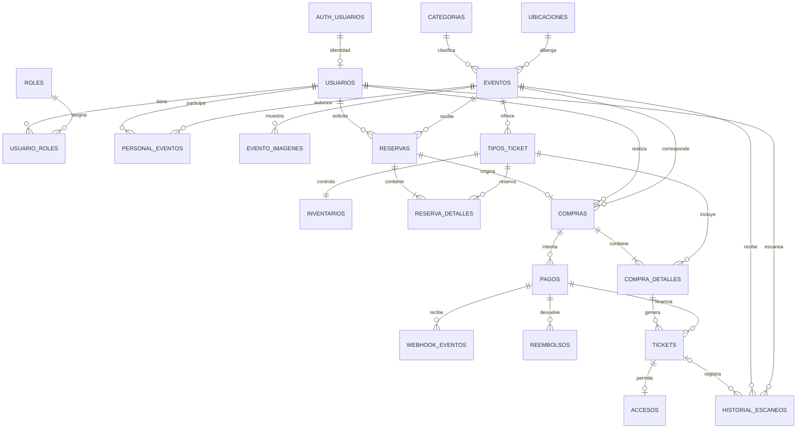

# Plan de trabajo — Plataforma de tickets

## 1. Objetivo y alcance

Fuente: [Mapa maestro de la plataforma](Vtickets_requerimientos.md).

Construir un MVP que permita completar el flujo: publicar evento → reservar boletos → pagar → emitir tickets individuales con QR → validar un único acceso por ticket.

El proyecto parte del mapa maestro, sin implementación existente. Todas las tareas de este documento comienzan pendientes. Se organizará como monolito modular con frontend separado, API central y base de datos relacional.

Cada fase incluye tareas, dependencias, entregables y criterios de aceptación. Las pruebas se desarrollarán junto con cada funcionalidad; la fase de validación integral consolidará la revisión del sistema completo.

No se asignan fechas, responsables ni estimaciones hasta conocer la capacidad del equipo. El siguiente stack queda como base provisional para desarrollar y probar, priorizando herramientas gratuitas y planes Free. En la primera fase se fijarán versiones compatibles y se verificarán los límites de las cuentas; el hosting de producción se resolverá antes de habilitar ventas reales.

### 1.1. Stack provisional de desarrollo

**Stack de momento:** TypeScript en frontend y backend, Next.js para la web, NestJS para la API y Supabase Free como plataforma de PostgreSQL, autenticación y almacenamiento. Frontend, API y worker se ejecutarán localmente; Stripe se usará exclusivamente en pruebas y los correos locales se capturarán sin enviarlos a clientes.

Es una combinación adecuada para este proyecto porque permite compartir lenguaje y contratos, desarrollar una web pública con renderizado en servidor y mantener las reglas comerciales en módulos de backend. Supabase reduce el trabajo de administrar servicios básicos y conserva PostgreSQL como base relacional para transacciones, restricciones e inventario concurrente. Esta es una recomendación de arquitectura para el MVP, no una garantía de rendimiento sin pruebas de carga.

| Capa | Tecnología propuesta | Uso en el proyecto |
|---|---|---|
| Lenguaje y ejecución | TypeScript y una versión LTS soportada de Node.js | Compartir lenguaje y tipos de contratos; fijar versiones compatibles al iniciar. |
| Frontend | Next.js con App Router y React | Catálogo y detalle renderizados en servidor; checkout, administración y scanner como interfaces interactivas. |
| Interfaz | Tailwind CSS y shadcn/ui | Componentes consistentes y adaptables a móvil para cliente, administración y acceso. |
| Backend | NestJS con API REST y OpenAPI | Monolito modular con autorización, eventos, inventario, reservas, compras, pagos, tickets y accesos. |
| Base de datos | PostgreSQL administrado por Supabase Free | Datos de negocio compartidos para pruebas; Supabase CLI local para desarrollo aislado. Supabase proporciona PostgreSQL; no es un motor de base de datos diferente. |
| Acceso a datos | Prisma ORM y migraciones SQL versionadas | Consultas tipadas y migraciones del esquema de negocio; SQL parametrizado para bloqueos u operaciones que lo requieran. |
| Identidad | Supabase Auth | Registro, login, recuperación y renovación de sesión; NestJS verifica la identidad y aplica los permisos del negocio. |
| Archivos | Supabase Storage | Imágenes de eventos y archivos privados si se incorporan; guardar referencias en PostgreSQL. |
| Pagos | Stripe Checkout en sandbox | Simular pagos, rechazos y webhooks sin dinero real; mantener PaymentService para poder cambiar de proveedor. |
| Correo | Capturador local incluido con Supabase CLI; Resend Free para pruebas externas | Verificar mensajes sin consumir cuota localmente; usar Resend por HTTPS y SMTP personalizado de Auth cuando se prueben envíos reales. |
| Tareas durables | Worker Node.js del mismo backend y tabla outbox en PostgreSQL | Reintentos de correos, recuperación de emisión, conciliación y expiración de reservas sin incorporar Redis inicialmente. |
| Pruebas | Jest y Supertest en backend; Playwright para recorridos web | Validar API, permisos, flujo completo y concurrencia contra PostgreSQL real de pruebas. |
| Desarrollo y entrega | pnpm workspaces, Docker local y GitHub Free con Actions dentro de cuota | Repositorio con frontend y backend separados; ejecución reproducible y verificaciones automatizadas. Revisar elegibilidad de Docker Desktop. |
| Hosting inicial | Equipo local para Next.js, NestJS y worker; Supabase Free para servicios compartidos | Sin contratar hosting de aplicaciones por ahora. Render Free queda como opción de demostración de la API, sin promesa de disponibilidad ni worker gratuito permanente. |

**Cómo se conectan las piezas**

```text
Next.js ── autenticación ──> Supabase Auth
Next.js ── API REST + token de usuario ──> NestJS
NestJS ── Prisma / transacciones SQL ──> PostgreSQL en Supabase
NestJS ── archivos autorizados ──> Supabase Storage
NestJS ── crear pago / reembolsar ──> Stripe
Stripe ── webhook verificado ──> NestJS
Worker del backend ── tareas persistidas en PostgreSQL ──> Resend / conciliación
```

**Decisiones de integración con Supabase**

- Usar Supabase Auth como única fuente de credenciales. El perfil de negocio se vincula mediante el identificador del usuario de Auth; no duplicar contraseñas ni construir un segundo emisor de sesiones en NestJS.
- Verificar firma, emisor, audiencia y expiración de tokens en NestJS con las claves del proyecto y una biblioteca mantenida. Usar claves de firma asimétricas y su JWKS; consultar roles, estado de cuenta y asignación a eventos en el backend para aplicar los permisos actuales.
- Hacer pasar las operaciones y consultas de negocio por NestJS. El navegador no escribirá directamente reservas, compras, pagos, tickets o accesos mediante la API automática de Supabase.
- Mantener las tablas de negocio en un esquema no expuesto por la Data API. Aplicar privilegios mínimos al usuario de conexión del backend y políticas RLS en recursos expuestos y Storage. Una conexión Prisma no hereda automáticamente la identidad del usuario ni las políticas asociadas a su JWT; el backend debe autorizar cada operación.
- Mantener claves secretas, claves service_role y credenciales de PostgreSQL exclusivamente en servidor. La clave pública de Supabase no concede por sí sola permisos de negocio.
- Conectar Prisma mediante conexión directa para el backend persistente si la red lo permite, o mediante Supavisor en modo sesión si se requiere IPv4. Dimensionar el pool y usar una conexión apta para migraciones siguiendo la documentación; no asumir que todos los modos de pooling son intercambiables.
- Usar las migraciones del backend como fuente del esquema de negocio, incluyendo SQL de restricciones y permisos; no mantener dos historiales de migración para las mismas tablas. Auth y Storage conservan sus esquemas administrados.
- Publicar imágenes de catálogo solo cuando corresponda y usar acceso privado para archivos sensibles. No almacenar QR de clientes en buckets públicos.
- Implementar reservas, confirmación y acceso único con transacciones cortas y restricciones de PostgreSQL. No mantener una transacción abierta mientras se llama al proveedor de pagos o de correo.
- Guardar trabajos outbox junto con el cambio de negocio en la misma transacción. El worker reclamará trabajos con bloqueo, reintentos y recuperación de trabajos interrumpidos; la expiración de reservas se determina por la hora almacenada, no por un temporizador en memoria.

**Validaciones antes de adoptar el stack**

- Confirmar que Stripe admite la cuenta del negocio y los medios de pago necesarios. Para el primer flujo, proponer tarjeta y una sola moneda; si se requieren OXXO, transferencias u otros medios diferidos, resolver primero la política de reservas y confirmaciones tardías.
- Validar costos y límites de alojamiento, conexiones, correo, almacenamiento, egreso, backups y recuperación. No basar una operación con ventas reales en la disponibilidad de planes gratuitos.
- Separar desarrollo, pruebas y producción; usar Supabase local mediante CLI y Docker cuando sea viable. Las pruebas de integración deben usar PostgreSQL, no reemplazarlo por SQLite.
- Fijar versiones estables compatibles y mantener lockfile. Comparar latencia entre API y base de datos y probar carga representativa antes de abrir ventas.
- Considerar la dependencia adicional de Supabase Auth y Storage: PostgreSQL facilita mover los datos, pero migrar identidad y archivos requiere trabajo específico.

### 1.2. Gratuidad, límites y uso provisional

Revisión de documentación oficial: **19 de octubre de 2026**. Los límites pueden cambiar; comprobarlos al crear las cuentas. Se priorizan planes gratuitos continuos frente a pruebas que expiran. No se contratarán suscripciones ni se activarán cobros reales como parte de este plan de desarrollo.

| Herramienta o servicio | Modalidad elegida | Límites y decisión |
|---|---|---|
| TypeScript, Node.js, Next.js, NestJS, Tailwind CSS, shadcn/ui y Prisma ORM | Herramientas de código abierto ejecutadas localmente | Sin suscripción de estas herramientas; no contratar productos cloud adicionales de Prisma. Mantener sus avisos de licencia. |
| Supabase | Free y CLI local | Free incluye 500 MB de base de datos por proyecto, 1 GB de archivos y hasta dos proyectos activos. Puede pausarse por baja actividad durante siete días. Usar local para trabajo diario y un proyecto Free para integración compartida; exportar datos y archivos de prueba, sin asumir backups de pago. |
| Resend | Free para envíos externos de prueba | Actualmente 3,000 correos/mes y 100/día. Usar un dominio propio verificado para destinatarios generales; adquirir el dominio puede tener costo. Sin dominio, mantener captura local y las pruebas restringidas permitidas por el proveedor. No habilitar automatizaciones de marketing. |
| Stripe | Sandbox y CLI | Probar sin mover dinero real. Al habilitar cobros habrá comisiones: no se considera gratuito el procesamiento de ventas. Confirmar tarifas del país antes del lanzamiento. |
| GitHub y Actions | GitHub Free | Repositorios privados o públicos; Actions sujeto a minutos, almacenamiento y tipo de runner. Usar runners Linux estándar, retención corta y bloqueo de gasto adicional cuando esté disponible; ejecutar verificaciones localmente si se agota la cuota. |
| Docker | Motor local; Docker Desktop solo si corresponde su modalidad gratuita | Desktop es gratuito para uso personal y pequeñas empresas con menos de 250 empleados y menos de USD 10 millones de ingresos anuales. Si no se cumple, usar Docker Engine en Linux sin contratar Desktop. |
| Render | Free opcional para demostrar la API | El servicio web se suspende tras 15 minutos sin tráfico y tiene 750 horas gratuitas mensuales compartidas por workspace. No usarlo como worker permanente ni como base para accesos en eventos reales; no usar su PostgreSQL Free, que expira a los 30 días. |
| Vercel | Excluido del hosting provisional | Hobby se limita a uso personal no comercial. No asumir que una demo de este proyecto comercial cumple esa condición; Next.js seguirá local hasta elegir hosting apto. |

**Operación durante el desarrollo**

- Ejecutar Next.js, NestJS y el worker en el equipo de desarrollo. Una demo de API en Render no reemplaza el worker local: mientras esté apagado, los trabajos pendientes permanecerán en PostgreSQL hasta la siguiente ejecución.
- Probar webhooks con Stripe CLI hacia NestJS local. No publicar credenciales ni necesitar un dominio de pago para este flujo.
- Usar el capturador de correo del entorno Supabase local para verificar recuperación de contraseña y mensajes. Resend Free queda para pruebas externas puntuales con destinatarios autorizados.
- Si se agota una cuota gratuita, reducir consumo o continuar localmente; no actualizar automáticamente a un plan de pago. Las pruebas temporales no serán una dependencia del desarrollo diario.
- Antes de vender entradas, resolver disponibilidad continua de API y worker, backups restaurables y capacidad de correo. Los servicios con suspensión no sostendrán el scanner de un evento real. Revisar entonces el presupuesto de hosting, dominio y comisiones.

**Fuentes de planes y condiciones**

- [Supabase: precios y cuotas Free](https://supabase.com/pricing) y [pausa de proyectos](https://supabase.com/docs/guides/platform/free-project-pausing).
- [Resend: plan gratuito](https://resend.com/pricing).
- [Stripe: pruebas sin dinero real](https://docs.stripe.com/testing).
- [GitHub: facturación y cuotas de Actions](https://docs.github.com/en/billing/concepts/product-billing/github-actions).
- [Docker: condiciones de Personal](https://www.docker.com/products/personal/).
- [Render: limitaciones de Free](https://render.com/docs/free).
- [Vercel: restricciones de uso comercial](https://vercel.com/docs/limits/fair-use-guidelines).

**Documentación de referencia**

- [Next.js: componentes de servidor y cliente](https://nextjs.org/docs/app/getting-started/server-and-client-components).
- [NestJS: documentación oficial](https://docs.nestjs.com/).
- [Supabase: conexión a PostgreSQL](https://supabase.com/docs/guides/database/connecting-to-postgres), [JWT y validación de identidad](https://supabase.com/docs/guides/auth/jwts) y [seguridad por filas](https://supabase.com/docs/guides/database/postgres/row-level-security).
- [Prisma: transacciones](https://www.prisma.io/docs/orm/fundamentals/transactions).
- [Stripe: confirmación y entrega después del pago](https://docs.stripe.com/checkout/fulfillment).
- [Resend: integración con Node.js](https://resend.com/docs/send-with-nodejs).

### 1.3. Comentarios didácticos para aprender Next.js y NestJS

El desarrollador está comenzando con Next.js y NestJS. Las primeras implementaciones deberán incluir comentarios didácticos en español, junto al código correspondiente, para poder aprender siguiendo el funcionamiento real de la aplicación.

- Explicar el propósito de los archivos y conceptos nuevos cuando aparezcan por primera vez, sin asumir experiencia previa en estos frameworks.
- En Next.js, comentar las primeras rutas, layouts, páginas, componentes de servidor y cliente, el motivo de usar `use client` y el recorrido de una consulta hacia la API. Indicar qué código se ejecuta en servidor y cuál en el navegador.
- En NestJS, comentar el arranque de la aplicación y los primeros módulos, controladores, servicios, DTO, validaciones, guards e inyección de dependencias. Aclarar términos como decorador o provider al introducirlos.
- Usar el primer flujo de eventos como ejemplo guiado: página → petición HTTP → controlador → servicio → consulta a PostgreSQL → respuesta → pantalla. Colocar comentarios en cada punto para facilitar seguir el recorrido entre archivos.
- Explicar por qué se elige un patrón y cómo se conecta con el resto de la aplicación; evitar comentarios que solo repitan literalmente lo que hace una línea o comentar cada instrucción.
- Incluir ejemplos de entrada o salida cuando aclaren el concepto, sin datos personales ni secretos. Distinguir los conceptos del framework de las reglas propias de venta de tickets.
- Desarrollar al menos un ejemplo comentado por cada patrón nuevo que se incorpore durante las primeras fases; en usos posteriores, referenciar el ejemplo inicial cuando resulte útil y evitar duplicar explicaciones extensas.
- Mantener los comentarios actualizados cuando cambie el código. Conservar los ejemplos didácticos iniciales como referencia durante el desarrollo del MVP.

**Criterio de aceptación:** las primeras implementaciones de identidad y eventos permiten reconocer qué función cumple cada capa, dónde se ejecuta el código y cómo viajan los datos, leyendo los comentarios junto al código. La documentación complementa estas explicaciones, pero no sustituye los comentarios solicitados.

## 2. Reglas fundamentales

- El backend valida precios, disponibilidad, límites, permisos, estados de pago y validez del ticket.
- La reserva protege inventario durante un tiempo limitado; su creación y liberación deben resistir operaciones concurrentes.
- Los importes de una compra se conservan aunque cambien posteriormente los precios del catálogo.
- Solo la confirmación verificada del proveedor permite marcar la compra como pagada y emitir tickets.
- Los webhooks, la emisión y los reembolsos deben procesarse de forma idempotente.
- Cada entrada comprada genera un ticket individual con una credencial QR segura y difícil de predecir.
- Cada ticket permite como máximo un acceso válido, garantizado mediante transacciones y restricciones en base de datos.
- Los clientes consultan únicamente sus recursos; el personal de acceso opera únicamente sobre eventos autorizados.
- Las acciones administrativas relevantes y los intentos de escaneo quedan registrados.

## 3. Fases de trabajo

### Fase 01. Reglas de negocio y arquitectura

**Dependencias:** ninguna.

- [x] F01-T01 — Delimitar el MVP y separar las funcionalidades futuras indicadas en el mapa maestro.
- [x] F01-T02 — Documentar permisos de cliente, administrador y personal de acceso, incluyendo asignación de personal a eventos.
- [x] F01-T03 — Definir estados y transiciones de eventos, reservas, compras, pagos, tickets y reembolsos.
- [x] F01-T04 — Definir límites por compra y por usuario, duración de reservas, ventanas de venta y reglas de liberación de inventario.
- [x] F01-T05 — Definir cancelaciones, alcance del reembolso básico, tratamiento de tickets utilizados y pagos recibidos después de expirar una reserva.
- [x] F01-T06 — Partir del stack provisional de las secciones 1.1 y 1.2, fijar versiones compatibles y documentar cualquier ajuste de frontend, backend, base de datos, pruebas y autenticación.
- [x] F01-T07 — Verificar cuotas de Supabase Free, Resend Free, Stripe sandbox y GitHub Actions; documentar requisitos de cuenta y separar los costos futuros de producción del desarrollo gratuito.
- [x] F01-T08 — Registrar arquitectura, límites entre módulos, moneda inicial, manejo de fechas y zona horaria de eventos.

**Entregables:** reglas de negocio, matriz de permisos, diagramas de estados y decisiones de arquitectura.

**Aceptación:** las decisiones permiten diseñar datos, contratos y flujos críticos sin reglas pendientes que cambien su estructura.

### Fase 02. Modelo de datos y contratos

**Dependencias:** fase 01.

- [ ] F02-T01 — Desarrollar el modelo entidad-relación y esquema Prisma a partir de la arquitectura de tablas de la sección 7, validándolo contra las reglas de la fase 01.
- [ ] F02-T02 — Incorporar la asignación de personal a eventos y el registro necesario para idempotencia de pagos y reembolsos.
- [ ] F02-T03 — Definir claves, relaciones, índices y restricciones para identificadores únicos, importes, cantidades e integridad referencial.
- [ ] F02-T04 — Diseñar transacciones para reserva de inventario, confirmación de compras, emisión de tickets y consumo de accesos.
- [ ] F02-T05 — Establecer migraciones del esquema de negocio, permisos y políticas RLS pertinentes, datos de desarrollo y procedimiento seguro de creación del administrador inicial vinculado con Supabase Auth.
- [ ] F02-T06 — Documentar contratos REST para identidad, eventos públicos, administración, reservas, checkout, compras propias, pagos, webhooks, tickets y validación de accesos.
- [ ] F02-T07 — Definir autenticación, autorización, validación de entradas, paginación y respuestas de error en los contratos.

**Entregables:** diagrama de datos, especificación de contratos API y estrategia de migraciones.

**Aceptación:** el modelo representa el flujo completo y las restricciones impiden duplicar tickets o accesos válidos.

### Fase 03. Base técnica e identidad

**Dependencias:** fase 02.

- [ ] F03-T01 — Crear la estructura de frontend, backend por dominios, documentación, migraciones e infraestructura propuesta en el mapa maestro.
- [ ] F03-T02 — Configurar entornos, variables de ejemplo sin secretos, ejecución local y base de datos de desarrollo.
- [ ] F03-T03 — Preparar validación de configuración, manejo de errores, logs y comprobaciones de salud.
- [ ] F03-T04 — Integrar registro, inicio y cierre de sesión y recuperación con Supabase Auth; implementar perfil de negocio y verificación de tokens en NestJS.
- [ ] F03-T05 — Implementar roles, autorización en backend y controles de propiedad de recursos.
- [ ] F03-T06 — Aplicar protección de credenciales, limitación de intentos y controles de sesión acordes con la autenticación elegida.
- [ ] F03-T07 — Configurar integración continua con compilación, análisis estático y pruebas pertinentes.
- [ ] F03-T08 — Preparar el worker y la tabla outbox con reclamación segura, reintentos y recuperación de trabajos interrumpidos.
- [ ] F03-T09 — Comentar en español la estructura inicial de Next.js y NestJS y el primer flujo de identidad conforme a la sección 1.3, explicando los conceptos nuevos junto al código.

**Entregables:** proyecto ejecutable localmente, identidad funcional y controles de acceso comunes.

**Aceptación:** cada rol accede exclusivamente a sus operaciones; los recursos de un cliente no son visibles para otro.

### Fase 04. Eventos, inventario y administración

**Dependencias:** fase 03.

- [ ] F04-T01 — Implementar gestión de categorías y ubicaciones.
- [ ] F04-T02 — Implementar creación, edición, publicación y despublicación de eventos con validación de fechas y estado.
- [ ] F04-T03 — Integrar carga de imágenes en almacenamiento externo con controles de tipo, tamaño y permisos.
- [ ] F04-T04 — Implementar tipos de boleto, precios, stock, límites y ventanas de venta.
- [ ] F04-T05 — Impedir cambios de inventario incompatibles con entradas vendidas o reservadas.
- [ ] F04-T06 — Construir el panel administrativo básico y la gestión de personal autorizado por evento.
- [ ] F04-T07 — Registrar auditoría de cambios administrativos relevantes.

**Entregables:** administración funcional de eventos e inventario.

**Aceptación:** un administrador publica un evento completo sin modificar código; los usuarios sin permiso no pueden administrarlo.

### Fase 05. Experiencia pública

**Dependencias:** fase 04.

- [ ] F05-T01 — Construir landing, catálogo y detalle del evento.
- [ ] F05-T02 — Mostrar información del recinto, fechas, tipos de entrada, precios y disponibilidad entregada por la API.
- [ ] F05-T03 — Integrar navegación de registro, inicio de sesión y área de cliente.
- [ ] F05-T04 — Resolver estados de carga, catálogo vacío, evento agotado, no disponible y errores de comunicación.
- [ ] F05-T05 — Adaptar las pantallas a móvil y verificar navegación por teclado, etiquetas y mensajes comprensibles.
- [ ] F05-T06 — Incorporar un recorrido didáctico comentado del catálogo desde la página de Next.js hasta el controlador, servicio y consulta de datos en NestJS, y de regreso a la pantalla.

**Entregables:** web pública conectada con eventos reales de la aplicación.

**Aceptación:** un visitante descubre eventos publicados y consulta las opciones de compra disponibles.

### Fase 06. Reservas, checkout y compras

**Dependencias:** fases 04 y 05.

- [ ] F06-T01 — Implementar selección de tipo de ticket y cantidad con validación de límites en backend.
- [ ] F06-T02 — Crear reservas transaccionales que descuenten disponibilidad sin permitir sobreventa.
- [ ] F06-T03 — Implementar expiración y liberación idempotente de reservas, incluyendo recuperación después de reiniciar procesos.
- [ ] F06-T04 — Crear compras y detalles conservando los precios e importes calculados en servidor.
- [ ] F06-T05 — Integrar resumen de compra, vencimiento de reserva y estados del checkout.
- [ ] F06-T06 — Controlar solicitudes repetidas de creación de compra y transiciones incompatibles de estado.
- [ ] F06-T07 — Probar competencia por el último boleto, reservas expiradas y límites por usuario bajo concurrencia.

**Entregables:** checkout que prepara una compra pendiente para recibir el pago.

**Aceptación:** el inventario no se vuelve negativo, no se exceden límites y las reservas se liberan una sola vez.

### Fase 07. Integración de pagos

**Dependencias:** fase 06.

- [ ] F07-T01 — Crear la abstracción del proveedor para crear, consultar y reembolsar pagos y verificar notificaciones.
- [ ] F07-T02 — Integrar el flujo de pago con la compra y la reserva correspondientes.
- [ ] F07-T03 — Verificar autenticidad del webhook e importe, moneda y referencia de la operación.
- [ ] F07-T04 — Registrar y procesar eventos de forma idempotente, tolerando duplicados, reintentos y recepción fuera de orden.
- [ ] F07-T05 — Confirmar la compra exclusivamente desde una verificación del proveedor; mostrar el resultado real en el checkout.
- [ ] F07-T06 — Aplicar la política de pagos tardíos definida en la fase 01 sin producir sobreventa.
- [ ] F07-T07 — Implementar conciliación de operaciones pendientes y manejo de fallas entre proveedor y aplicación.

**Entregables:** pagos funcionales en entorno de pruebas y compra confirmada de forma verificable.

**Aceptación:** un retorno exitoso del navegador no basta para confirmar; eventos repetidos no duplican cobros iniciados ni efectos de confirmación.

### Fase 08. Tickets, QR y comunicación

**Dependencias:** fase 07.

- [ ] F08-T01 — Emitir un ticket por entrada de una compra pagada mediante un proceso idempotente y recuperable.
- [ ] F08-T02 — Generar identificadores públicos y credenciales QR criptográficamente seguras sin exponer datos personales innecesarios.
- [ ] F08-T03 — Construir Mis Tickets, detalle con QR e historial de compras con autorización de propiedad.
- [ ] F08-T04 — Mostrar estados de ticket y compra y resolver la espera entre confirmación y disponibilidad.
- [ ] F08-T05 — Enviar confirmación de compra y acceso a los tickets mediante un mecanismo con reintentos controlados.
- [ ] F08-T06 — Evitar registrar credenciales QR o secretos en logs.

**Entregables:** tickets individuales consultables y correo de confirmación.

**Aceptación:** una compra pagada produce exactamente los tickets comprados; una falla de correo no impide consultarlos ni provoca nueva emisión.

### Fase 09. Scanner y control de accesos

**Dependencias:** fase 08.

- [ ] F09-T01 — Construir login de personal, selección de eventos autorizados y scanner móvil con cámara.
- [ ] F09-T02 — Validar credencial, evento y estado del ticket desde backend.
- [ ] F09-T03 — Registrar el acceso y consumir el ticket en una operación atómica respaldada por una restricción de unicidad.
- [ ] F09-T04 — Mostrar resultados de ticket válido, ya utilizado, inválido, de otro evento, cancelado o reembolsado.
- [ ] F09-T05 — Guardar historial de intentos con operador, evento, fecha y resultado, evitando almacenar credenciales completas.
- [ ] F09-T06 — Manejar permisos de cámara, fallas de red y respuestas inciertas sin anunciar una entrada autorizada sin confirmación del servidor.
- [ ] F09-T07 — Probar escaneo concurrente del mismo ticket desde dos dispositivos.

**Entregables:** scanner móvil y consulta básica de accesos.

**Aceptación:** solo un escaneo autoriza la entrada; los posteriores informan que el ticket ya fue utilizado. El scanner requiere conexión.

### Fase 10. Cancelaciones y reembolsos

**Dependencias:** fases 07, 08 y 09.

- [ ] F10-T01 — Implementar cancelación del evento, bloqueo de ventas y tratamiento de reservas según las reglas definidas.
- [ ] F10-T02 — Identificar compras afectadas e invalidar los tickets correspondientes conforme a la política acordada.
- [ ] F10-T03 — Permitir al administrador solicitar el reembolso básico con controles contra solicitudes duplicadas.
- [ ] F10-T04 — Confirmar el resultado mediante el proveedor y actualizar compra, pago y tickets de forma consistente.
- [ ] F10-T05 — Manejar fallas y reintentos de reembolso sin declarar éxito antes de la confirmación.
- [ ] F10-T06 — Notificar cancelaciones y resultados de reembolso y registrar auditoría.

**Entregables:** operación administrativa de cancelación y reembolso básico.

**Aceptación:** los tickets invalidados no permiten entrada; los reintentos no duplican devoluciones y las fallas quedan visibles para seguimiento.

### Fase 11. Validación integral y seguridad

**Dependencias:** fases 03 a 10.

- [ ] F11-T01 — Ejecutar el recorrido completo de administrador, cliente y personal de acceso.
- [ ] F11-T02 — Ejecutar la matriz de pruebas críticas de la sección 4.
- [ ] F11-T03 — Revisar autorización, propiedad de datos, validación de entradas, sesiones, límites de solicitudes y protección de archivos.
- [ ] F11-T04 — Verificar recuperación ante fallas parciales en pagos, emisión, notificaciones y expiración de reservas.
- [ ] F11-T05 — Verificar la experiencia de checkout y scanner en teléfonos reales mediante HTTPS.
- [ ] F11-T06 — Comprobar que logs y auditoría permiten investigar fallas sin exponer contraseñas, secretos ni credenciales QR.
- [ ] F11-T07 — Corregir incidencias bloqueantes y documentar limitaciones conocidas.

**Entregables:** evidencia de pruebas, incidencias resueltas y candidato de lanzamiento.

**Aceptación:** el flujo principal y todos los escenarios críticos pasan sin fallas bloqueantes.

### Fase 12. Despliegue y operación

**Dependencias:** fase 11.

- [ ] F12-T01 — Preparar entornos separados de pruebas y producción, dominio y HTTPS.
- [ ] F12-T02 — Configurar frontend, API, base de datos, almacenamiento y procesos de trabajo programado.
- [ ] F12-T03 — Configurar secretos fuera del repositorio y accesos con mínimo privilegio.
- [ ] F12-T04 — Preparar despliegue reproducible, ejecución de migraciones y procedimiento de reversión compatible con los datos.
- [ ] F12-T05 — Automatizar backups y ejecutar una restauración de prueba.
- [ ] F12-T06 — Configurar monitoreo y alertas para errores, webhooks fallidos, pagos pendientes, emisión y tareas de reservas.
- [ ] F12-T07 — Documentar operación, conciliación de pagos, recuperación de tareas y atención de incidencias durante eventos.
- [ ] F12-T08 — Ejecutar el recorrido completo en el entorno previo a producción y verificar la configuración del proveedor antes de habilitar ventas reales.

**Entregables:** plataforma desplegable, procedimientos operativos y checklist de lanzamiento completado.

**Aceptación:** el entorno previo a producción supera el flujo completo y la restauración; producción dispone de monitoreo y procedimientos de recuperación verificados.

## 4. Matriz de pruebas críticas

| Escenario | Resultado esperado |
|---|---|
| Dos clientes intentan reservar el último boleto | Solo uno obtiene la reserva; no hay sobreventa. |
| Reserva expirada o liberación ejecutada varias veces | El inventario se recupera una sola vez. |
| Un cliente intenta exceder el límite con solicitudes simultáneas | El backend conserva el límite definido. |
| Precio o total modificado en el navegador | El servidor calcula y valida el importe real. |
| Cliente consulta compras o tickets de otra cuenta | Acceso rechazado sin exposición de datos. |
| Cliente o personal invoca endpoints administrativos | Operación rechazada por backend. |
| Webhook falso o con importe, moneda o referencia incorrectos | No se confirma la compra ni se emiten tickets. |
| Webhook duplicado o fuera de orden | No se duplican tickets ni se revierte indebidamente un estado confirmado. |
| Pago rechazado | No se emiten tickets y se aplica la liberación de reserva definida. |
| Pago confirmado después de expirar la reserva | Se aplica la política documentada sin sobreventa. |
| Falla después de confirmar pago y antes de completar emisión | La recuperación completa la emisión sin duplicarla. |
| QR inexistente, de otro evento, cancelado o reembolsado | No se autoriza entrada y se registra el intento. |
| Dos dispositivos escanean el mismo QR simultáneamente | Se registra un único acceso válido. |
| Personal intenta validar en un evento no autorizado | Operación rechazada. |
| Scanner pierde conexión o no conoce el resultado | No anuncia autorización sin confirmación; permite recuperar el estado mediante el flujo definido. |
| Solicitud o confirmación de reembolso repetida | No se duplica la devolución ni se corrompen los estados. |
| Falla el envío de correo | Los tickets siguen disponibles; la notificación puede reintentarse. |
| Restauración de backup | Los datos se recuperan y la aplicación vuelve a operar de manera consistente. |

## 5. Checklist de finalización del MVP

- [ ] Un administrador crea y publica un evento con tipos de boleto e inventario.
- [ ] Un cliente se registra, consulta el evento, reserva y paga.
- [ ] El pago confirmado genera tickets individuales consultables con QR.
- [ ] El personal autorizado registra un solo acceso por ticket.
- [ ] Cancelaciones y reembolsos básicos actualizan correctamente ventas y validez de tickets.
- [ ] Las operaciones críticas resisten concurrencia, reintentos y fallas parciales.
- [ ] Los permisos, la auditoría y las pruebas críticas están verificados.
- [ ] El despliegue, backups, restauración, monitoreo y procedimientos operativos están listos.

## 6. Evolución posterior al MVP

Mantener fuera del lanzamiento inicial la selección gráfica de asientos, aplicaciones nativas, scanner offline, wallets, reventa, transferencias, tickets y precios dinámicos, promociones avanzadas, fidelidad, venta física, múltiples organizadores, comisiones configurables, pagos divididos, facturación avanzada, BI, recomendaciones, afiliados, listas de espera, recurrencia avanzada, multiidioma y multimoneda.

La priorización de estas funciones se realizará después de validar la operación del MVP. No son dependencias para completar este plan.

## 7. Arquitectura de tablas de la base de datos

Base de datos: PostgreSQL en Supabase. Las tablas del proyecto se organizarán en el esquema `tickets_app`; Supabase Auth administrará las identidades en `auth.users`.

### Tablas por módulo

| Módulo | Tablas |
|---|---|
| Identidad y permisos | `usuarios`, `roles`, `usuario_roles`, `personal_eventos` |
| Eventos y catálogo | `categorias`, `ubicaciones`, `eventos`, `evento_imagenes`, `tipos_ticket` |
| Inventario y reservas | `inventarios`, `reservas`, `reserva_detalles` |
| Compras | `compras`, `compra_detalles` |
| Pagos | `pagos`, `webhook_eventos`, `reembolsos` |
| Tickets y accesos | `tickets`, `accesos`, `historial_escaneos` |
| Comunicación y operación | `notificaciones`, `auditoria`, `outbox_trabajos`, `idempotencia_solicitudes` |

### Relaciones principales



`AUTH_USUARIOS` representa `auth.users`. El diagrama resume las relaciones comerciales; las tablas de comunicación y operación se conectarán con los recursos correspondientes durante el diseño detallado de la fase 02.
